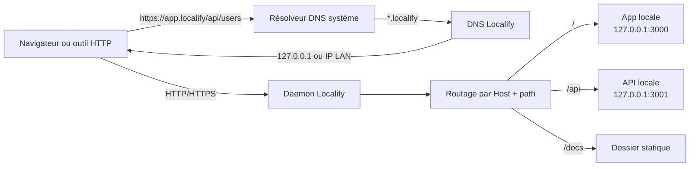
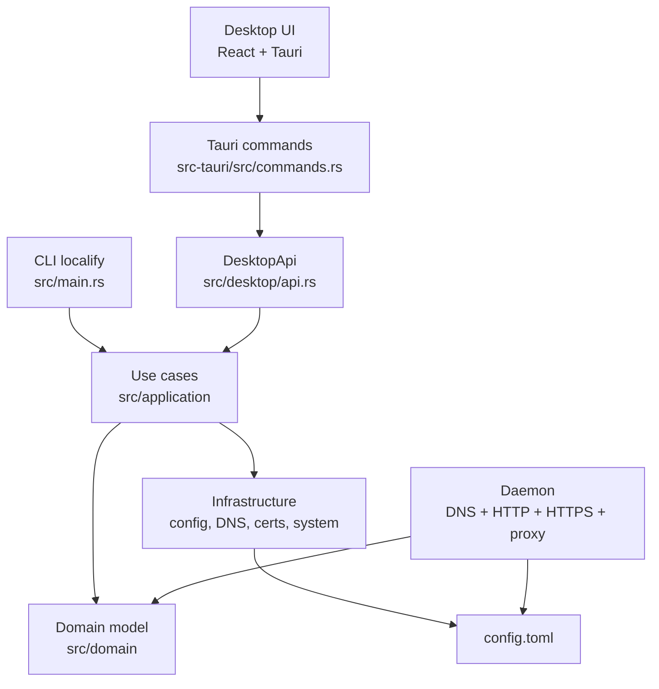
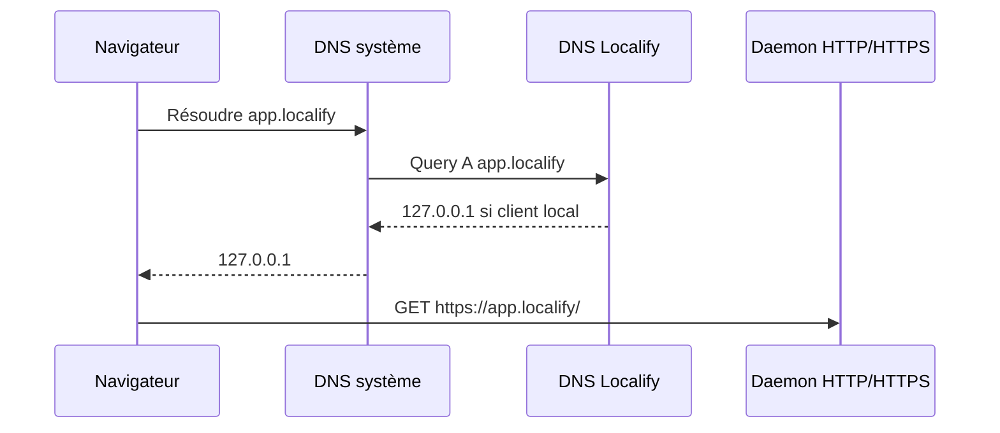
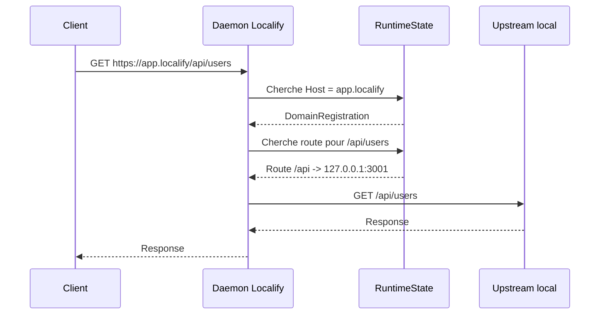
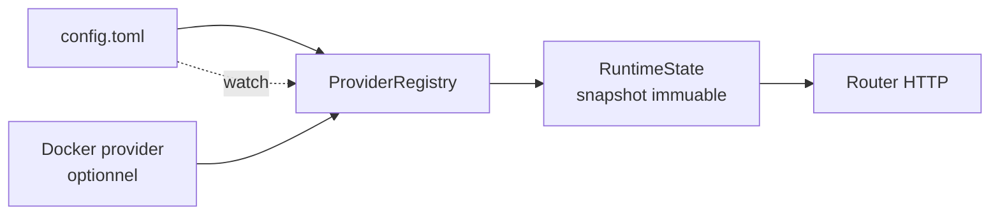
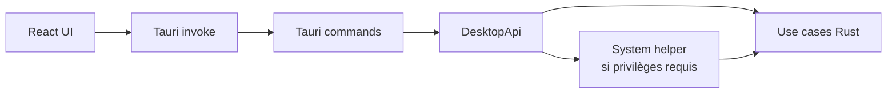
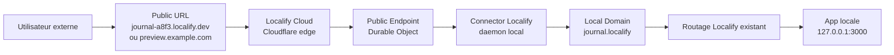
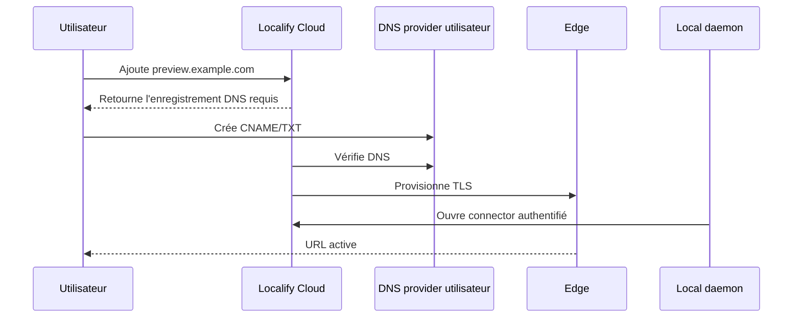

# Localify - fonctionnement technique

Ce document explique le fonctionnement actuel de Localify, puis montre comment la future fonctionnalité de Public URLs doit naturellement se brancher dessus.

Localify sert à remplacer des URLs de développement comme `http://localhost:3000` par des domaines locaux stables comme `https://app.localify`. L'application de développement continue de tourner sur son port habituel. Localify ajoute une couche locale devant elle: DNS, TLS, routage HTTP et logs.

## Modèle mental

Localify ne remplace pas le serveur de développement. Il agit comme une passerelle locale.



Le point important: le domaine local est la clé d'entrée. Ensuite, Localify choisit la bonne route selon le chemin.

## Composants principaux



Localify garde le frontend desktop mince. L'UI appelle Tauri, Tauri appelle `DesktopApi`, et `DesktopApi` délègue aux mêmes use cases que la CLI. La logique métier ne vit pas dans React.

## Installation locale

`localify install` prépare la machine:

1. Crée les dossiers de configuration et de données.
2. Crée un fichier `config.toml` si besoin.
3. Génère une Root CA locale et l'installe dans le trust store système.
4. Sur macOS, ajoute cette Root CA aux simulateurs iOS bootés via `xcrun simctl keychain`.
5. Configure le DNS système pour envoyer le suffixe `.localify` vers le DNS Localify.

Sur macOS, Localify écrit un résolveur dans `/etc/resolver/localify`. En mode production, les ports par défaut sont:

| Service | Port |
| --- | ---: |
| HTTP | `80` |
| HTTPS | `443` |
| DNS | `1053` |

En profil dev (`LOCALIFY_PROFILE=dev`), les ports deviennent `8080`, `8443` et `1054`, pour éviter de dépendre des ports privilégiés.

## Enregistrement d'un domaine

Un domaine local est enregistré avec une ou plusieurs routes.

```bash
localify register app.localify \
  --route "/=3000" \
  --route "/api=3001"
```

Ce que fait Localify:

1. Valide le domaine (`app.localify`) et les routes.
2. Crée un `DomainRegistration`.
3. Génère un certificat TLS signé par la Root CA locale.
4. Persiste la configuration dans `config.toml`.
5. Le daemon recharge l'état et peut servir le domaine.

Une route a ce format:

```text
PATH=TARGET
```

Exemples:

| Route | Effet |
| --- | --- |
| `/=3000` | Proxy vers `127.0.0.1:3000` |
| `/api=3001` | Proxy vers `127.0.0.1:3001` |
| `/admin=192.168.1.50:8080` | Proxy vers une machine précise |
| `/docs=/var/www/docs` | Sert un dossier statique |

Le matching de routes utilise le préfixe le plus long. Donc `/api/users` match `/api` avant `/`.

## DNS local

Le daemon inclut son propre serveur DNS. Il répond uniquement aux domaines qui finissent par le suffixe Localify.



Quand la requête DNS vient de la machine locale, Localify répond `127.0.0.1`. Quand elle vient d'un appareil du LAN, Localify peut répondre avec l'IP LAN de la machine. C'est ce qui permet d'ouvrir le domaine depuis un téléphone ou une tablette sur le même réseau.

## HTTPS et certificats

Localify génère une Root CA locale pendant l'installation. Chaque domaine enregistré reçoit ensuite un certificat signé par cette CA.

Pour un domaine exact:

```text
app.localify -> certificat pour app.localify
```

Pour un wildcard:

```text
*.app.localify -> certificat avec app.localify et *.app.localify
```

Le serveur HTTPS utilise le SNI pour choisir le bon certificat. Pour un domaine `.localify` valide mais non enregistré, Localify peut générer un certificat à la demande afin d'afficher une page d'erreur utile dans le navigateur au lieu d'une erreur TLS opaque.

## Routage d'une requête



Le daemon fait trois décisions:

1. Le `Host` correspond-il à un domaine connu?
2. Quel préfixe de route matche le chemin?
3. La cible est-elle un proxy HTTP/HTTPS ou un dossier statique?

Pour les routes proxy, Localify conserve le `Host` public vu par le client et ajoute les headers habituels:

```text
X-Forwarded-Host: app.localify
X-Forwarded-Proto: https
X-Forwarded-Port: 443
X-Forwarded-For: <client-ip>
```

Il retire aussi les hop-by-hop headers (`Connection`, `Keep-Alive`, `Transfer-Encoding`, etc.) pour respecter le comportement attendu d'un reverse proxy.

Les WebSockets sont supportés pour les cibles HTTP. Localify transfère ensuite les octets dans les deux sens entre le client et l'upstream.

## Wildcards

Un domaine wildcard match le domaine racine et un seul niveau de sous-domaine.

```text
app.localify           -> match
api.app.localify       -> match
a.b.app.localify       -> ne match pas
```

Cette limite est volontaire. Elle garde le modèle simple et évite de créer une sémantique différente entre le local et les futures Public URLs.

Quand plusieurs registrations pourraient matcher, Localify trie par spécificité. Le domaine le plus spécifique gagne, et un exact gagne sur un wildcard équivalent.

## Rechargement et état runtime

Le daemon charge les registrations depuis plusieurs providers:

- le fichier de config;
- Docker, si l'intégration Docker est activée.

Il construit ensuite un `RuntimeState` immuable. Quand la config change, le daemon recharge les registrations et remplace l'état en une opération atomique. Les requêtes en cours continuent d'utiliser un snapshot cohérent.



Un socket de management local permet aussi à la CLI ou au desktop de demander l'état du daemon, déclencher un reload, lire les ports actifs, etc.

## Desktop app

L'application desktop est une interface au-dessus du même coeur Rust.



La règle d'architecture est simple: l'UI affiche et déclenche des actions, mais elle ne réimplémente pas la logique de domaines, routes, DNS, certificats ou daemon.

## Ce que ça implique pour les Public URLs

Le bon modèle n'est pas de faire pointer une URL publique directement vers un port local. Le bon modèle est d'exposer un domaine Localify déjà configuré.



Cette architecture garde un seul endroit pour les règles importantes:

- activation/désactivation du projet;
- matching exact ou wildcard;
- routes par préfixe;
- diagnostics locaux;
- logs;
- erreurs lisibles quand la cible locale ne répond pas.

Le cloud devient une entrée publique vers un domaine local, pas un deuxième routeur concurrent.

## Modèle Public URLs recommandé

Les termes importants:

| Terme | Sens |
| --- | --- |
| Local Domain | Domaine `.localify` configuré dans un projet |
| Public Endpoint | Exposition cloud d'un Local Domain |
| Public URL | URL internet attachée au Public Endpoint |
| Persistent Public URL | URL Localify-owned, par exemple `journal-a8f3.localify.dev` |
| Custom Public URL | Hostname utilisateur, par exemple `preview.example.com` |
| License Identity | Identité cloud dérivée de la licence active |

Un endpoint cible un domaine local:

```text
Public URL -> Public Endpoint -> Local Domain -> Route Target
```

Pas:

```text
Public URL -> port local
```

## Custom domain public

Pour une URL custom, le flux technique doit rester explicite:



La vérification DNS, le certificat public et l'état du connector doivent être des états séparés. Un domaine custom peut être bien configuré côté DNS mais offline parce que la machine locale n'est pas connectée. À l'inverse, le connector peut être online alors que le DNS custom est encore en attente.

## Contraintes importantes pour la v1 publique

- Les Public Endpoints s'attachent aux domaines locaux configurés dans les projets.
- Les domaines Docker ou externes ne sont pas dans le scope v1.
- Un domaine local a au plus un Public Endpoint actif.
- Un Public Endpoint peut avoir plusieurs Public URLs.
- Le wildcard garde la même sémantique que le local: racine + un seul label.
- L'access protection se fait côté cloud, avant d'atteindre le connector local.
- Les exceptions d'access protection doivent rester des préfixes de chemin, comme les routes locales.
- Les opérations desktop doivent aussi exister en CLI, sous `localify public-url`.
- Le connector utilise des tokens courts liés à l'endpoint, la machine et la licence. Il ne doit pas envoyer la licence brute sur une session longue.

## Résumé

Localify fonctionne parce qu'il garde le modèle local très simple:

```text
Domain -> Routes -> Targets
```

Le DNS local fait arriver le trafic au daemon. Le TLS local rend les domaines utilisables dans un vrai navigateur. Le router choisit la bonne registration et la bonne route. Le proxy envoie ensuite la requête vers l'app locale sans que l'app ait besoin de connaître Localify.

Les Public URLs doivent prolonger ce modèle au lieu de le dupliquer:

```text
Public URL -> Cloud -> Connector -> Local Domain -> Routes -> Targets
```

C'est ce qui permet d'avoir des URLs publiques propres tout en conservant les mêmes diagnostics, les mêmes règles de routage, la même CLI et la même expérience desktop.
