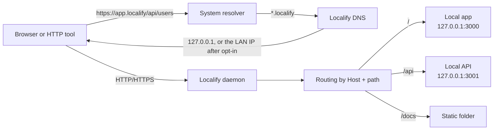
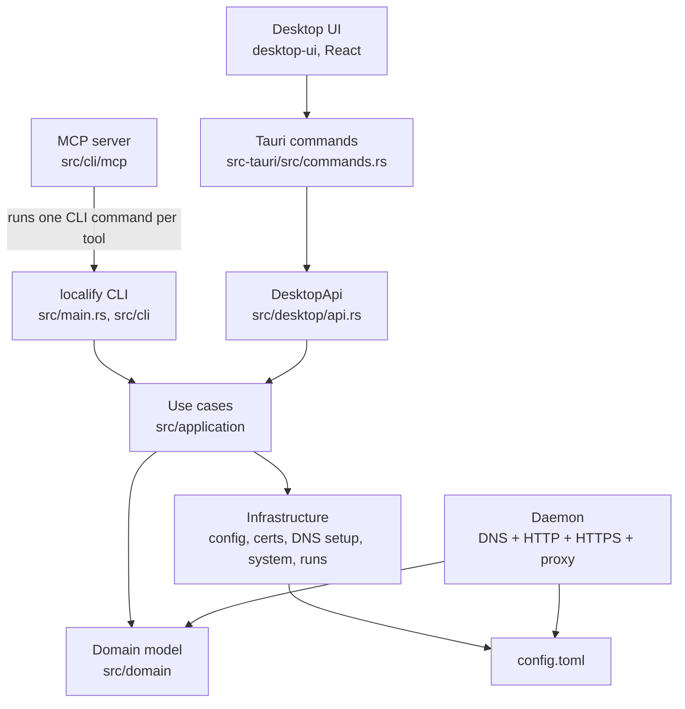
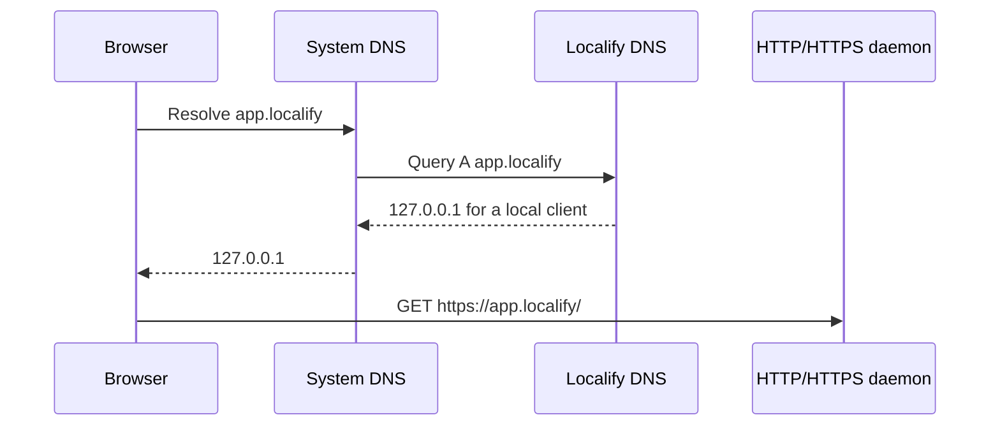
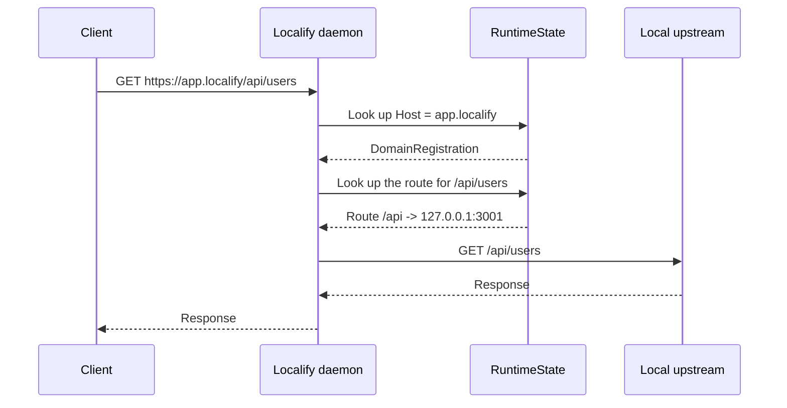
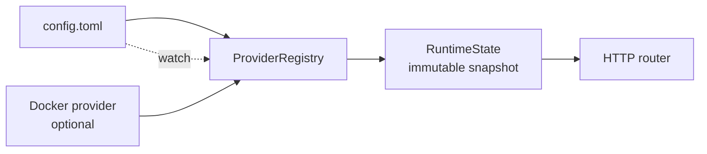
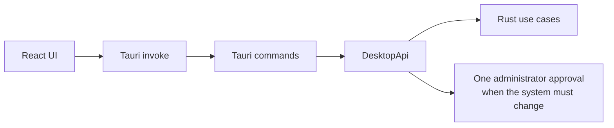
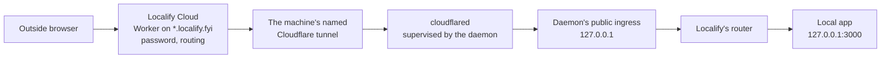

# How Localify works

This page explains how Localify's pieces fit together, for contributors. It starts with
the local proxy, then covers services, the desktop app, public URLs and remote machines.
The words it uses are defined in [CONTEXT.md](../CONTEXT.md). The contracts in
[public-urls.md](public-urls.md), [remote-machines.md](remote-machines.md) and
[launch-profiles.md](launch-profiles.md) give the details, and [adr/](adr/) the
decisions.

Localify replaces development URLs such as `http://localhost:3000` with stable local
domains such as `https://app.localify`. The dev server keeps running on its own port.
Localify puts DNS, TLS, routing and logs in front of it.

## The mental model

Localify doesn't replace the dev server. It's a local gateway.



The local domain is the key. Once a request arrives, Localify picks the route by path.

## Main components



The desktop frontend stays thin. The UI calls Tauri, Tauri calls `DesktopApi`, and
`DesktopApi` calls the same use cases as the CLI. Business logic doesn't live in React.
The MCP server adds no logic either: each tool runs one `localify` command and returns
its output ([ADR 0018](adr/0018-agents-use-localify-through-its-mcp-server.md)).

The CLI and the app talk to the running daemon over a management socket, a Unix socket
only its owner can open: status, reload, the inventory of services, cloud state, remote
machines. Most requests get one JSON answer per connection; the remote ones, such as
pairing, controls and following output, stream their answers.

## Installing

`localify install` prepares the machine:

1. Creates the configuration and data folders, and `config.toml` if needed.
2. Generates a local root CA, limited to the `.localify` suffix by a critical name
   constraint.
3. On macOS, adds that CA to booted iOS Simulators with `xcrun simctl keychain`.
4. Points the system resolver at Localify's DNS for the `.localify` suffix.
5. Hands the daemon to launchd or systemd, which opens the privileged ports and runs it
   as the user.
6. Connects the coding agents it finds to `localify mcp`.

On macOS, one administrator approval writes `/etc/resolver/localify` and the launchd
plist. Trusting the CA in browsers is a separate step, `localify trust`, confirmed in a
macOS window. On Linux with systemd, one `sudo` writes the resolver config, the units and
the CA trust. After the install, no Localify process runs as root
([ADR 0017](adr/0017-no-root-process-after-install.md)). The default ports are:

| Service | Port |
| --- | ---: |
| HTTP | `80` |
| HTTPS | `443` |
| DNS | `1053` |

The dev profile (`LOCALIFY_PROFILE=dev`, used by `pnpm tauri:dev`) uses `8080`, `8443` and
`1054`, and the `.localify.test` suffix, so it never touches an installed Localify.

## Registering a domain

A local domain is registered with one or more routes.

```bash
localify register app.localify \
  --route "/=3000" \
  --route "/api=3001"
```

Localify then:

1. Validates the domain and the routes.
2. Creates a `DomainRegistration`.
3. Generates a TLS certificate signed by the local CA.
4. Saves the configuration in `config.toml`.
5. Asks the running daemon to reload, so it serves the new domain.

A route is `PATH=TARGET`:

| Route | Effect |
| --- | --- |
| `/=3000` | Proxy to `127.0.0.1:3000` |
| `/api=3001` | Proxy to `127.0.0.1:3001` |
| `/admin=192.168.1.50:8080` | Proxy to another machine |
| `/docs=/var/www/docs` | Serve a static folder |

The longest prefix wins, so `/api/users` matches `/api` before `/`.

Most domains belong to a project. `localify dev` and `localify init-project` create
projects and their domains: `project.localify` for a single service,
`web.project.localify` for each service of a monorepo
([ADR 0010](adr/0010-service-domain-generation.md)), and one more label per worktree
environment ([ADR 0009](adr/0009-project-environment-local-domain-names.md)).

## Local DNS

The daemon includes its own DNS server. It answers only names under the Localify suffix.



A query from the machine itself gets `127.0.0.1`. With a normal install, the daemon
listens on loopback only. After `localify lan enable`, a query from another device on the LAN gets
the machine's LAN address, so a phone or a tablet on the same network can open the
domain.

## HTTPS and certificates

The install generates a local root CA. Each registered domain gets a certificate signed
by it:

```text
app.localify   -> certificate for app.localify
*.app.localify -> certificate for app.localify and *.app.localify
```

The HTTPS server picks the certificate by SNI. For a valid `.localify` name that isn't
registered, Localify generates a certificate on demand, so the browser shows a useful
error page instead of an opaque TLS error.

## Routing a request



The daemon makes three decisions:

1. Does the `Host` match a known domain?
2. Which route prefix matches the path?
3. Is the target an HTTP proxy or a static folder?

For proxy routes, Localify keeps the `Host` the client sent and adds the usual headers:

```text
X-Forwarded-Host: app.localify
X-Forwarded-Proto: https
X-Forwarded-Port: 443
X-Forwarded-For: <client-ip>
```

It strips hop-by-hop headers (`Connection`, `Keep-Alive`, `Transfer-Encoding`…), as a
reverse proxy should. WebSockets work for HTTP targets: Localify then copies bytes both
ways between the client and the upstream.

## Wildcards

A wildcard domain matches its base domain and one level of subdomain:

```text
app.localify      -> matches
api.app.localify  -> matches
a.b.app.localify  -> doesn't match
```

The limit is deliberate. It keeps the model simple, and the same as for public URLs.
When several registrations could match, the most specific one wins, and an exact domain
wins over an equivalent wildcard.

## Reloading and runtime state

The daemon loads registrations from providers:

- the config file;
- Docker, when the Docker integration is on.

It builds an immutable `RuntimeState` from them. When the config changes, the daemon
reloads the registrations and swaps the state atomically. Requests in flight keep a
consistent snapshot.



## Services and runs

`localify dev` resolves a service of a project, picks its port, builds its variables
(the URL variables, then any [launch profile](launch-profiles.md)), and runs its
command. Each execution is a run, with a run id. For a run in the app or in the
background, the `localify dev` process that executes it leads the run's session and
process group, so stopping the run stops everything it started. Each run's output and record live in the user's `services/` folder, which is how
`localify logs`, `services status`, `stop` and `restart` work from any folder and for
any owner.

A run has one owner:

- **the app:** a service tab, which is a pseudo-terminal the desktop app creates with
  `localify dev` as its only child;
- **the background:** `localify dev --detach`, with no terminal;
- **a terminal** Localify doesn't own, when someone runs `localify dev` in their shell.

`localify dev --in-app` hands a launch to the running app through the app bridge, a Unix
socket the app listens on while it runs. The daemon uses the same bridge for starts
requested by another machine. The details, including how launches are fenced so a
service never starts twice, are in [remote-machines.md](remote-machines.md), "Output"
and "Controls".

## Desktop app

The desktop app is an interface over the same Rust core.



The rule is simple: the UI shows things and triggers actions, but never reimplements the
logic of domains, routes, DNS, certificates, the daemon or the cloud. Rust owns every
PTY; the UI renders them with xterm.js. See [desktop.md](desktop.md) and
[ARCHITECTURE.md](ARCHITECTURE.md).

## Public URLs

A public URL doesn't expose a local port. It exposes a Localify domain that's already
configured, and public traffic goes through the same router as local traffic. The full
contract is in [public-urls.md](public-urls.md).



That keeps one place for the rules that matter: whether the project is enabled, exact
and wildcard domains, route prefixes, diagnostics and logs. The cloud is a public way in
to a local domain, not a second router.

- `journal.localify.fyi` exposes a project's local domain, and its name follows the
  local one. With `--wildcard`, `journal--feature.localify.fyi` reaches
  `feature.journal.localify`, so every environment of the project. The app creates one
  URL per project, on its namespace `<project>.localify`.
- The Worker checks the password before anything reaches the machine. A URL is
  protected by default.
- Each signed-in machine has its own tunnel. The Worker sends it a secret of that
  machine, and the daemon's public ingress refuses any request without it.
- The app gets the local domain in `Host` and the public host in `X-Forwarded-Host`.
- Public traffic can't trigger the `/.localify/` actions, and its error pages show no
  path or command.
- Everything the app does exists in the CLI, under `localify public-url`, and as MCP
  tools.

The Worker lives in `apps/cloud/`; its [README](../apps/cloud/README.md) covers the code
and how to run it.

## Remote machines

Paired machines of one account see and control each other's services. Every daemon
connects out to a relay in Localify Cloud, one per account, and nothing listens on a
machine for remote access. The relay forwards opaque frames: what machines say to each
other is end-to-end encrypted (Noise) between keys a person pinned when pairing, so
Localify Cloud routes it without reading it.

```text
viewer: app or CLI ─▶ daemon ══ Noise ══▶ relay ══ Noise ══▶ daemon ─▶ inventory, output, controls
                                       (Localify Cloud)              └─▶ app bridge, for starts in a tab
```

A target shares nothing until its person turns on `share`, and accepts no start, stop or
restart until they turn on `control`. The contract is in
[remote-machines.md](remote-machines.md), and the decisions in ADRs 0028 to 0033.

## Summary

Localify works because it keeps the local model simple:

```text
Domain -> Routes -> Targets
```

Local DNS brings the traffic to the daemon. Local TLS makes the domains work in a real
browser. The router picks the registration and the route. The proxy then sends the
request to the local app, which doesn't need to know about Localify.

Public URLs extend that model instead of copying it:

```text
Public URL -> Worker -> Tunnel -> Local Domain -> Routes -> Targets
```

That's how public URLs keep the same diagnostics, the same routing rules, the same CLI
and the same desktop experience.
